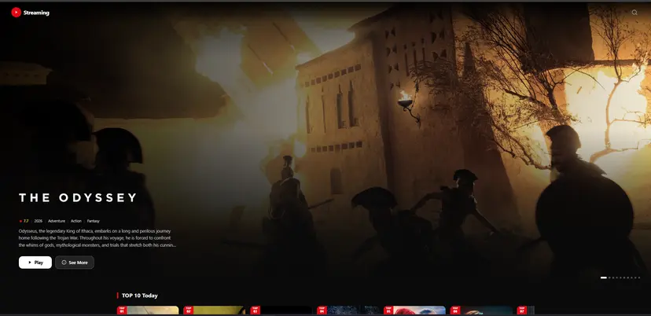

# Streaming App

A self-hosted web application for discovering movies and TV shows and playing
them through a user-configured streaming source. Streaming App combines a
cinematic React interface with a single Next.js application and is designed for personal
deployments on home servers and low-power devices such as a Raspberry Pi.

## Overview

Streaming App uses [The Movie Database (TMDB)](https://www.themoviedb.org/) for
search, artwork, cast information, trailers, episodes, collections, and
recommendations. Playback uses configurable HTTPS embed templates stored in
SQLite. Anyone with access to the private deployment manages sources from the settings cog beside search;
viewers can switch enabled sources directly in the player.

The project is one TypeScript application using Next.js App Router. The existing
React components provide browsing and playback, while Node.js Route Handlers keep
the TMDB API key private, validate requests, normalize TMDB responses, and resolve
stream URLs. One process serves the interface and API.

## Preview

### Home page



### Details page


## Features

- Movie and TV discovery powered by TMDB
- Auto-cycling hero slideshow with backdrop artwork and title logos
- Top 10, trending, top-rated, and genre-based browsing sections
- Search overlay with movie and TV filters, debounced results, and recent
  searches stored locally in the browser
- Detailed title pages with ratings, runtime, genres, overview, cast, trailers,
  recommendations, and related movie collections
- TV season selector and episode browser
- Cross-season episode search with cached season data
- Actor pages with biography, known-for titles, movies, and TV credits
- Full-screen iframe player for movies and individual TV episodes
- Responsive React and Tailwind CSS interface
- Validated Node.js Route Handlers with structured error responses, security headers, and
  development request logging
- Multiple persistent providers, ordering, media compatibility, and a shared default
- Manual provider URL templates with optional movie/TV previews
- In-player source switching with separate last-used movie and TV preferences

## Tech stack

| Area | Technologies |
| --- | --- |
| Interface | Next.js 16.4.3 App Router, React 19, TypeScript, Tailwind CSS 4.1.18, Axios |
| Server | Next.js Node.js Route Handlers, Axios, Joi; equivalent API security headers |
| Metadata | TMDB API with persistent SQLite caching; official IMDb ratings dataset |
| Storage and scheduling | Node.js built-in `node:sqlite` / `DatabaseSync` (WAL), node-cron, dedicated IMDb child process |
| Playback | User-configured embed provider |

## Project structure

```text
streaming-app/
├── src/
│   ├── app/                # App Router pages and /api Route Handlers
│   │   ├── api/{health,tmdb,streams}/
│   │   ├── title/[type]/[id]/
│   │   ├── play/[type]/[id]/
│   │   └── actor/[id]/
│   ├── api/                # Existing browser-side Axios clients
│   ├── components/         # Existing UI, including screens/
│   ├── hooks/              # Existing data fetching and UI behavior
│   └── lib/server/         # Private integrations, transforms and validation
├── public/                 # Original favicon
├── preview/                # Original README screenshots
├── .env.example
├── next.config.ts
├── package.json
└── README.md
```

## Prerequisites

- Node.js 22.16.0+ on the 22.x line, or Node.js >=24.0.0, with `node:sqlite` enabled
- npm
- A [TMDB API key](https://www.themoviedb.org/settings/api)
- Permission to access and embed the streaming sources you configure

SQLite ships with Node.js; Windows does not need Visual Studio C++ Build Tools
or a separate SQLite installation. Next.js and esbuild still use their normal
platform-specific binaries, installed by npm.

## Setup

Run all commands from the repository root:

```bash
npm ci
cp .env.example .env.local
```

On Windows PowerShell, copy the environment file with:

```powershell
Copy-Item .env.example .env.local
```

Set the values in `.env.local`:

```env
TMDB_API_KEY=YOUR_TMDB_API_KEY
```

Then start the application:

```bash
npm run dev
```

Open [localhost:3000](http://localhost:3000). No separate backend or proxy is
needed. Credentials stay server-side; use no `NEXT_PUBLIC_*`
variables for private credentials.

## Environment variables

| Variable | Required | Description |
| --- | --- | --- |
| `TMDB_API_KEY` | Yes for metadata | Server-side TMDB API key |
| `DATABASE_PATH` | No | SQLite file path; default `./data/streaming.db`, relative to the process working directory |
| `PORT` | No | Development listen port; defaults to 3000. Production `npm start` explicitly uses port 2222, overriding `PORT`; pass `--port` to select a different production port |

Next.js loads `.env.local` automatically. Production can instead supply the
variables through its service manager. Never commit secrets. `BACKEND_PORT` is
obsolete. Next.js sets `NODE_ENV` for development and production itself.

## Streaming providers

Fresh installations seed **VidSrc** (`https://vidsrc.mov`) as the enabled default:

```text
Movie: https://vidsrc.mov/embed/movie/{tmdbId}
TV:    https://vidsrc.mov/embed/tv/{tmdbId}/{season}/{episode}
```

These retain the existing application's embed paths. A seeded or documented
template is not a claim about live playback, title availability, or access rights.
Providers must allow the intended embedding; users are responsible for using only
sources they are authorized to access. The app never extracts, downloads, proxies,
or transcodes video, or bypasses provider restrictions.

### Open settings and add a source

1. Start the application and click the **cog beside Search** on the homepage.
2. Choose **Add provider**, enter its name and public HTTPS base URL (a bare domain
   is also accepted).
3. Copy the movie and/or TV URL format from your provider's documentation, replacing
   its media ID with `{tmdbId}` and TV episode values with `{season}` and `{episode}`.
   Leave unsupported media types blank. Live example URLs show validation errors.
4. Optionally open **Preview The Dark Knight (2008)** (TMDB 155) or
   **Preview Game of Thrones · S1 E1** (TMDB 1399) to try the
   generated URL. No playback confirmation is required.
5. Choose enabled/default settings, then **Save provider**.

**Edit**, **Enable / Disable**, **Make default**, arrow ordering controls,
and a two-step **Delete → Confirm delete** are available on each source. Changes
take effect without a restart. Disabling/deleting the default transactionally
promotes the first enabled source; no default exists when all sources are disabled
or deleted. Deleting all providers is permitted and is not undone on restart.

### Manual templates and watching

Supported placeholders are `{tmdbId}`, `{season}`, and `{episode}` in URL paths or
query values. Movie templates require `{tmdbId}`; TV templates require all three.
IMDb IDs are used only by ratings and are never streaming identifiers.

```text
https://example.com/watch/{tmdbId}
https://example.com/player?id={tmdbId}&s={season}&e={episode}
```

Templates must be absolute HTTPS URLs on port 443 with the same origin as their
base URL. Credentials, fragments, HTML, unsafe schemes, IP-literal hosts, and
unsupported placeholders are rejected. Only positive integer TMDB/season/episode
values are substituted and encoded, and the final URL is checked again. A base
URL may include a path prefix. At most 50 sources can be configured.

On a movie or episode player page, click the small **cogwheel** in the upper-right
corner to open the source picker. It only switches between configured sources;
provider management is available exclusively from the homepage settings. The picker
closes after selection, on Escape, or when clicking outside it.
Selection prefers the browser's last chosen source for that media type, then a
compatible default, then the first enabled compatible source in configured order.
Movie and TV preferences have separate localStorage keys. Private browsing or
unavailable localStorage does not prevent playback. Source changes preserve the
page, TMDB ID, season and episode but may restart playback position.
The player's Back button returns directly to the page that opened playback,
regardless of source changes or iframe history. Direct player links return to
the current title's details page.
Disabled or incompatible sources are omitted. Lists refresh on window focus and visibility.
Unchanged URLs keep their iframe; missing/deleted sources
fall back safely, and no compatible sources produces a link back to the homepage.

### Manual configuration and previews

URL formats are entered manually. There is no format discovery endpoint, provider
scanning, or automatic verification. Provider configuration and playback URL
resolution make no outbound server requests to streaming providers. The optional
preview loads the supplied URL directly in a browser iframe.

The homepage providers dialog fades and slides into view; animations respect the
system's reduced-motion preference. The player's compact source picker has no
provider management controls.

### Provider management

Anyone who can access the site can list, add, edit, enable, disable, reorder,
preview, and delete providers. Settings open directly with no login,
admin token, or generated key file. Provider management is shared application
state for this private deployment, not per-viewer configuration.

Management browser requests must use the application's own origin.
Reverse proxies should preserve the public `Host` and set the correct
`X-Forwarded-Proto` for Next.js. Same-origin checks prevent unrelated websites
from making changes through a visitor's browser; they do not restrict visitors
who already have access to the deployment.

Provider templates accept public HTTPS domain URLs on port 443, reject credentials,
HTML and unsupported placeholders, and must share the configured base origin.
Management requests are limited to 60 per minute per server process. Request JSON
is capped at 16 KiB with a five-second read timeout.

### Migration and troubleshooting

Schema version 2 adds `stream_providers` to the existing SQLite file. It stores
stable IDs, normalized unique base URLs, optional movie/TV templates, enabled/default
flags, priority, and Unix-ms timestamps. A partial unique index permits only one
default; default changes and
reordering use IMMEDIATE transactions. Cache eviction and IMDb maintenance never
delete provider settings, and provider operations do not touch metadata or ratings.
Schema version 3 removes the old discovery and playback-confirmation columns while
preserving provider IDs, URLs, enabled states, defaults, ordering, and timestamps.

`STREAM_SOURCE` is read **only once**, while applying migration 2. A custom HTTPS
source retains the old `/embed/movie/...` and `/embed/tv/...` paths as the enabled
default alongside VidSrc. Existing VidSrc installations migrate directly. Subsequent
restarts do not reseed, overwrite edits, or read that variable for playback. After
the first successful upgrade, remove it from your deployment. Invalid/insecure
legacy URLs cause the migration to roll back with a validation error rather than
silently replacing the configuration; correct the legacy URL to its working public
HTTPS equivalent before retrying. Preserve a backup of the database before upgrading.

- **Blank or blocked preview:** the provider may prohibit framing, require browser
  authentication, block the network, lack the title, or be unavailable. A preview
  cannot bypass these restrictions. Edit the template or try another authorized source.
- **Source missing from player:** enable it and provide a template for the current
  media type. Reopen/focus the player to refresh its source list.
- **Wrong default appears:** an explicit browser preference takes precedence. Select
  the desired source in that media type's player or clear its `xalonstream:provider:movie`
  / `xalonstream:provider:tv` localStorage entry.
- **Rate limited:** wait a minute before retrying. Management limits are shared
  across viewers in the single server process.

## Available scripts

| Command | Description |
| --- | --- |
| `npm run dev` | Start one Next.js development server |
| `npm run build` | Create and type-check the production application |
| `npm start` | Serve the production application, including its API, on port 2222 |
| `npm run lint` | Run ESLint with zero warnings allowed |
| `npm run typecheck` | Run TypeScript without emitting files |
| `npm run test:db` | Test legacy database copies, transactions, cache, IMDb imports/locks, and provider CRUD |
| `npm run imdb:import` | Manually refresh the official IMDb dataset using the safe worker importer |
| `npm run imdb:rankings` | Prepare saved movie/series rankings from the existing IMDb dataset |
| `npm run build:tools` | Rebuild generated Node.js maintenance/worker bundles |

## API overview

All application endpoints are served below `/api`.

| Method | Endpoint | Description |
| --- | --- | --- |
| `GET` | `/api/health/ping` | Check whether the backend is responding |
| `GET` | `/api/tmdb/search?q={query}&type={type}` | Search movies, TV shows, or both |
| `GET` | `/api/tmdb/trending?type={type}&window={window}` | Get daily or weekly trending titles |
| `GET` | `/api/tmdb/movie/{tmdbId}` | Get movie details, credits, and videos |
| `GET` | `/api/tmdb/tv/{tmdbId}` | Get TV details, credits, and videos |
| `GET` | `/api/tmdb/tv/{tmdbId}/season/{season}` | Get a season and its episodes |
| `GET` | `/api/tmdb/tv/{tmdbId}/episodes` | Get episodes across every season |
| `GET` | `/api/tmdb/{type}/{tmdbId}/recommendations` | Get related titles |
| `GET` | `/api/tmdb/{type}/{tmdbId}/images` | Get preferred title logo artwork |
| `GET` | `/api/tmdb/collection/{tmdbId}` | Get a movie collection |
| `GET` | `/api/tmdb/top-rated/{type}` | Get IMDb-ranked movies or TV shows, with TMDB fallback |
| `GET` | `/api/tmdb/genres/{type}` | List movie or TV genres |
| `GET` | `/api/tmdb/discover/{type}/{genreId}` | Discover titles by genre |
| `GET` | `/api/tmdb/person/{personId}` | Get person details and selected credits |
| `GET` | `/api/streams/movie/{tmdbId}` | Resolve a movie embed URL |
| `GET` | `/api/streams/tv/{tmdbId}/{season}/{episode}` | Resolve a TV episode embed URL |
| `GET` | `/api/providers` | List enabled sources for playback (public) |
| `GET` | `/api/providers/management` | List all providers |
| `POST` | `/api/providers` | Add a provider |
| `PATCH` | `/api/providers` | Reorder with `{ "ids": ["..."] }` containing every provider |
| `PATCH` | `/api/providers/{id}` | Update fields, including enabled/default flags |
| `DELETE` | `/api/providers/{id}` | Delete a provider |

Stream endpoints accept optional `?providerId=...` and return `{ url, providerId }`;
missing/disabled/incompatible choices fall back using the shared default and order.
Provider APIs use `{ "error": "..." }` for 400/403/404/409/429 responses and
generic 500 responses without database details; 429 includes `Retry-After: 60`.
All provider responses use `Cache-Control: no-store`.

`type` accepts `movie` or `tv` unless an endpoint states otherwise. Search also
accepts `multi`, trending accepts `all`, and the trending window accepts `day`
or `week`. IDs, seasons, and episode numbers must be positive integers. Invalid
requests return a `400` response with the original Joi structure:

```json
{
  "code": "VALIDATION_FAILED",
  "message": "Validation failed",
  "details": { "params": { "tmdbId": "\"tmdbId\" must be a positive number" } }
}
```

Service errors retain their `{ "error": "..." }` body and HTTP status. Unknown
query keys are rejected by search/trending. GET handlers also support HEAD;
unsupported methods use the framework's 405 response. All TMDB requests use the
shared SQLite cache below the Axios service. Handlers remain dynamic with
`Cache-Control: no-store`; no Next.js fetch cache or independently expiring
render cache stores metadata. Existing client state caches remain unchanged.

Title details and normalized cards add a backward-compatible `rating` field:

```ts
{ value: 8.8, voteCount: 2679053, source: "imdb" } // source: "imdb" | "tmdb" | null
```

Original TMDB fields, including `vote_average` and `vote_count`, are preserved.
IMDb is preferred when a local mapping and rating exist. Otherwise TMDB is used;
missing ratings remain hidden. Ratings display only their numeric value, without
source labels. Homepage hero,
Top 10, trending, genre and top-rated cards, search, title details, actor-credit
cards, collection cards and recommendation grids share this behavior. Discovery
ordering outside the Top rated row and all navigation/player identifiers remain TMDB-based.

The homepage **Top rated on IMDb** row selects and orders titles from the active
local IMDb ratings dataset, rather than reordering a TMDB top-rated page. Movies
require at least 25,000 IMDb votes; series require 10,000. Candidates sort by IMDb
rating descending, then vote count descending, then IMDb ID for stable ties. This
is an application ranking, not a reproduction of IMDb's Top 250 chart formula.
Up to 1,000 qualifying candidates are scanned to return 20 titles per media type.
TMDB's external-ID find endpoint supplies movie/series classification, metadata,
artwork and navigation IDs; episode matches and adult titles are excluded.
Preparation runs in the background worker after the daily import. Lookups use
the shared persistent metadata cache and at most six concurrent requests.
Both complete lists are saved together in the separate `imdb_top_rated` table;
homepage requests only read that saved JSON and never scan ratings or resolve
IMDb IDs. Yesterday's lists remain available throughout preparation, across
server restarts, and after failed refreshes. Metadata-cache eviction does not
delete the prepared lists. A worker lease and an import-generation check prevent
overlapping workers or a concurrent import from publishing inconsistent lists.

Startup and the 15-minute maintenance check also prepare missing or outdated
lists, even when the downloaded ratings are already fresh. Failed preparation
uses the scheduler's normal retries. New lists become visible on the next page
reload or Movies/Series toggle after preparation completes. To prepare the lists
without downloading the dataset again, run `npm run imdb:rankings` after building
the maintenance tools (`npm run build:tools`). Manual dataset imports also prepare
both lists.

Until the first lists are prepared, the row uses TMDB's top-rated list and
displays **Top rated**. The endpoint's `rankingSource`
field (`imdb` or `tmdb`) identifies which ranking was used; individual cards keep
their existing preferred-rating behavior. No additional IMDb download is needed.

## SQLite storage and migrations

On Node.js server startup, `src/instrumentation.ts` opens the database, creates
its parent directory, and applies migrations before serving requests. Builds
do not initialize the scheduler or import data. Database imports are marked
`server-only`; database files must live outside `public/` and are ignored by Git.
One connection is reused per absolute path and process through `globalThis`,
including development reloads. SQLite uses WAL, NORMAL synchronization, a
5-second busy timeout, and a 4 MiB page cache per connection.

Storage uses Node.js's built-in `DatabaseSync` directly. Node.js 22.16.0 is the
minimum on the 22.x line for its connection timeout and transaction-state APIs.
Node.js 23 is unsupported because it lacks the required transaction-state API. No experimental
flag is needed. Node.js 22 emits an experimental SQLite warning. This is expected;
the module's stability and bundled SQLite version depend on the Node.js release.
Custom Node.js builds must include SQLite, and `--no-experimental-sqlite` must not
be set on versions that support that flag. The database remains server-side in the
Node.js runtime; Edge runtimes are unsupported.

Upgrading from `better-sqlite3` keeps the same `DATABASE_PATH`, SQLite file,
schema, and `PRAGMA user_version` migration history (currently version 4). There
is no driver-specific data migration or reseeding. Stop the app and workers,
make a consistent backup as described below, upgrade Node.js if necessary, then
run `npm ci`, `npm run build`, and restart against the existing path. Do not
delete the database or its WAL/SHM files during the upgrade.

Prepared statements retain positional bindings. Transactions use explicit
BEGIN/COMMIT/ROLLBACK, with savepoints for nested provider updates; write-locking
operations retain IMMEDIATE mode. Transaction callbacks must stay synchronous.
PRAGMAs execute as SQL, and cache eviction converts statement change counts to
numbers. The IMDb worker uses the same built-in driver and lease protocol.

Migrations in `src/lib/server/db/migrations.ts` run in an IMMEDIATE transaction
and advance SQLite `PRAGMA user_version` only when committed. A database with a
newer schema is rejected rather than downgraded. Version 1 creates:

| Table | Key and stored data |
| --- | --- |
| `api_cache` | `cache_key` primary key; JSON, creation/expiry/stale/access timestamps, UTF-8 response byte count |
| `imdb_ratings` | `imdb_id` primary key; average rating, vote count, update timestamp |
| `imdb_mappings` | `(media_type, tmdb_id)` composite key; nullable IMDb ID, update and expiry timestamps |
| `imdb_top_rated` | Saved movie/series card lists, source import timestamp, preparation timestamp |
| `import_metadata` | One row; attempt/success/failure timestamps, status, duration, active row count, error, source URL/ETag/Last-Modified/bytes, sampled peak RSS |
| `job_locks` | Named lock, unique owner token, lease expiry |
| `cache_statistics` | Cumulative named counters, flushed in batches |

Cache stale expiry and last access, and mapping expiry, have indexes. Ratings
and mapping lookups use their primary keys. All timestamps are Unix milliseconds.
IMDb reference tables are independent from disposable API cache eviction.

## TMDB cache policies

`src/lib/server/tmdbClient.ts` is the only upstream client, shared by all
services, Route Handlers and any future runtime Server Component callers.
Current page components fetch through API routes; none fetch metadata during
static generation. A future Server Component caller must render at request
time (for example with Next.js `connection()`), without `use cache` or
`unstable_cache` around this service.

Request keys include resource paths and sorted query parameters (language,
region, page, search query, append fields, filters, etc.), excluding credentials.
The persistent cache stores raw successful responses; rating enrichment happens
after cache reads so daily IMDb updates do not wait for TMDB cache expiry.

| Resource | Default TTL |
| --- | --- |
| Trending movie/TV/all | 2 hours |
| Popular and genre discovery | 6 hours |
| Top rated | 24 hours |
| Now playing / airing | 6 hours |
| Upcoming | 6 hours |
| Movie details, artwork, collections | 7 days |
| TV details, artwork, seasons and episodes | 24 hours |
| Person details and credits | 14 days |
| Recommendations and similar | 24 hours |
| Search | 1 hour |
| Genres and configuration | 30 days |
| TMDB-to-IMDb mappings, including known missing IDs | Up to 30 days |

Defaults are centralized in `cache/config.ts`; routing policies are in
`cache/policies.ts`. Upstream `max-age`, `Age`, `Expires` and shorter
`stale-while-revalidate` directives reduce these lifetimes. `no-store`, `private`
and `no-cache` responses are not retained; `must-revalidate` prevents stale use.
Mappings derived from cached external IDs cannot outlive the source response's
permitted lifetime. Deployment owners must also honor any more restrictive
[TMDB API agreement](https://www.themoviedb.org/api-terms-of-use) applicable to
their key; the application cannot discover account-specific contract terms.

Fresh cache hits return immediately without TMDB requests. Expired entries
within the permitted 24-hour default stale grace return immediately while one
background refresh runs. Misses share an in-flight promise per key and process.
There are at most six active upstream requests, with up to two short retries
for temporary/network errors. Repeated failures apply a bounded per-key backoff;
errors never replace cached JSON. Stale data is never served past `stale_until`.
Background work is best effort; the next request retries after restart.

Cleanup runs on startup/traffic and every 15 minutes. It deletes entries past
their stale lifetime and evicts least-recently-used entries to keep cached JSON
under 250 MiB. Writes enforce the budget immediately; access timestamps are
updated at most hourly per entry. The budget excludes IMDb data, SQLite indexes,
free pages and WAL overhead. SQLite reuses freed pages; this is a logical JSON
budget, not a 250 MiB database-file limit. Cache cleanup never deletes ratings
or mappings; expired mappings are maintained separately. Images and streams
continue using their existing browser/CDN/provider paths.

The local request inventory is: `/search/{type}`, `/trending/{type}/{window}`,
`/movie/{id}`, `/tv/{id}`, `/tv/{id}/season/{season}`, recommendations, images,
collections, top-rated lists, genres, discovery, person details with appended
combined credits, and movie/TV external IDs for ratings. The all-episodes service
uses the same cached TV/season paths. Playback services do not use this cache.

## Automatic IMDb ratings

Ratings come exclusively from the official
[IMDb non-commercial datasets](https://developer.imdb.com/non-commercial-datasets/),
using `https://datasets.imdbws.com/title.ratings.tsv.gz` as a source constant.
No scraping, per-title IMDb requests, paid APIs or additional credentials are used.

This data is for **individual personal, non-commercial use** under IMDb's
[licensing conditions](https://help.imdb.com/article/imdb/general-information/can-i-use-imdb-data-in-my-software/G5JTRESSHJBBHTGX)
and [conditions of use](https://www.imdb.com/conditions). It is not licensed by
this project's MIT license. Public redistribution, republishing or commercial
deployment requires appropriate permission/licensing; do not distribute the
generated database with the source code. Data attribution:
Information courtesy of [IMDb](https://www.imdb.com). Used with permission.

At startup, an empty dataset or a last success older than 24 hours starts a
nonblocking child-process import. Fresh data skips the download. `node-cron`
runs `0 4 * * *` in UTC with `noOverlap`. The daily job refreshes for that day's
04:00 slot even if a startup import was less than 24 hours earlier. A 15-minute
maintenance check recovers stale data after missed ticks or machine sleep.
No external cron/systemd timer is needed.

The importer streams HTTPS bytes through gzip decompression and incremental TSV
parsing. It validates headers, title IDs, 0–10 ratings, and nonnegative integer
votes; missing/malformed records are rejected. Batches of 1,000 rows commit to
a staging table while readers continue using active ratings. Duplicate IDs,
truncated gzip/downloads, size limits, more than 1% invalid rows, fewer than
1,000,000 valid rows, or a decrease below 80% of the previous row count fail
validation. Only a fully completed import atomically swaps staging into place
and records success/source metadata. Failure preserves active ratings and records
the error.

In-process controller overlap prevention and an atomic SQLite lock protect
imports across processes. A unique owner holds a two-minute lease, renewed every
20 seconds and checked before batch writes and activation. A crashed worker's
lease expires; the next owner discards abandoned staging. An old owner cannot
activate or delete its successor's staging. Workers have a 45-minute import
budget, a parent watchdog, and stop if the serving parent disappears. Shutdown
stops cron/maintenance and supervises the child where practical.

Failed automatic imports retry after 1, 5 and 30 minutes. Normal maintenance and
the next daily/startup check provide later recovery. IMDb failures do not stop
the app. Until data is available, the UI continues displaying TMDB ratings.

Mappings reuse movie `imdb_id` and TV appended `external_ids`. Collections use a
single SQLite batch join for all ratings. Unresolved mappings return TMDB ratings
immediately and queue background TMDB external-ID requests, with two resolver
workers, a 200-title queue, per-ID deduplication and failed-lookup cooldowns.
Known missing IDs are stored as NULL. No resolution requests run before the
dataset exists. Newly resolved ratings appear on subsequent metadata requests;
existing frontend state is not polled or reset.

Manual maintenance, normally unnecessary:

```bash
npm run imdb:import
```

The manual import uses the same child-process importer/lock, forcing a refresh
when no import owns the lock. Internal cache counters remain in SQLite; there is
no public administration endpoint.

## Backup, restoration and persistent deployment

Keep the database outside replaceable release directories. For Docker, mount a
local persistent volume, for example `-v streaming-data:/app/data`, with the app
working directory `/app`; alternatively mount `/var/lib/streaming-app` and set
`DATABASE_PATH=/var/lib/streaming-app/streaming.db`. Ensure the serving user can
write the whole directory (SQLite needs WAL/SHM siblings). Never mount it as
static content. Use local disk, not a network filesystem, for WAL locking.

For a live backup, use SQLite's online backup API/CLI, for example:

```bash
sqlite3 data/streaming.db ".backup 'streaming-backup.db'"
```

Alternatively stop the application cleanly before copying its database. Do not
copy only a live `.db` file while ignoring its WAL. Restore with the server
stopped: move the old database **and its matching WAL/SHM files** aside, copy the
backup to `DATABASE_PATH`, restore permissions, then start the app. Startup checks
schema and refreshes missing/outdated ratings. Never mix sidecars from different
database snapshots. Back up IMDb tables if avoiding a full recovery download
matters; API cache entries are disposable.

`scripts/build-tools.mjs` uses esbuild to bundle the TypeScript IMDb importer into
`runtime/imdb-worker.cjs`, which Node.js launches in a separate process so imports
do not block the Next.js request-serving event loop. It runs automatically before
`npm run dev` and `npm run build`; it does not download or import the dataset.
Keep `runtime/` in production alongside dependencies;
the worker needs a supported Node.js version (22.16+ on 22.x, or 24+) with built-in SQLite,
not TypeScript/esbuild at runtime. Maintenance npm scripts build missing bundles
when development dependencies are available. Rebuild tools after source edits.

The current deployment uses `next start`. If you opt into `output: 'standalone'`,
runtime bundles are included by explicit tracing rules; SQLite is supplied by Node.js.
Copy `public/` and `.next/static/` as Next.js documents, verify `runtime/` is beside
the standalone `server.js`, and launch from that directory. If your packaging
tool omits these files, copy `runtime/` there explicitly. Use an absolute
`DATABASE_PATH` to keep data independent of standalone/release working directories.
For standalone maintenance, run `node runtime/imdb-worker.cjs --force` with the
deployment environment supplied.

On Raspberry Pi, prefer a supported 64-bit OS and Node.js LTS with built-in SQLite.
Install dependencies on the target architecture for Next.js's platform binaries.
SQLite requires no separate native addon or C++ build tools. Use reliable storage (preferably
SSD), allow space for both old and staging datasets plus WAL, and leave build
memory headroom. Imports stream in a separate process with a small SQLite page
cache; actual Pi duration/memory must be measured on the device.

One continuously running instance is the intended model. Multiple processes on
the same local database coordinate imports through leases, but each has its own
cron/controller, TMDB in-flight deduplication and mapping queue. They can duplicate
TMDB misses. SQLite serializes writers; very high write concurrency can hit the
busy timeout. Serverless/Edge/static-only hosting is not supported for automatic
refresh. No cache or scheduler environment toggles are needed.

## Development checks

Check the application and build it for production:

```bash
npm run lint
npm run typecheck
npm run test:db
npm run build
```

Database tests use temporary files under `.test-build/` and populated legacy
schema fixtures at versions 1–4. They migrate copies, verify original files and
existing rows remain intact, and exercise rollback, WAL readers, competing writers,
lease ownership, importer failure recovery, saved rankings, cache and providers.
They use local compressed IMDb fixtures and stub TMDB lookups; they do not download
the full IMDb dataset or require an API key. To validate deployment-specific data,
also start the upgraded app against a consistent backup copy of that database.

## Production deployment

Build and start from the repository root:

```bash
npm ci
npm run build
npm start
```

Open [localhost:2222](http://localhost:2222). The production start script uses
port `2222`; development continues to use port `3000`.

For a different production port:

```bash
npm start -- --port 1111
```

Keep the production build (`.next`), generated `runtime/`, `public`, `package.json`, the lockfile,
`next.config.ts`, and installed dependencies together. Supply `TMDB_API_KEY`
at runtime; providers persist in SQLite. No Vercel account, static export, separate API
process, or SPA fallback configuration is needed. A reverse proxy can forward
all requests to this one Node.js server. Do not serve `.next` as a static site.

Self-hosting on a Raspberry Pi is supported subject to Next.js/Node.js support
for the device's OS and CPU. Build on the target platform or a compatible build
host; native dependencies installed on Windows cannot be copied to Linux. Allow
enough RAM for the production build.

For a private deployment, place the application behind a firewall, VPN, or
authenticated reverse proxy. Use HTTPS when accessing it across a network and
only configure sources you are authorized to use.

## Content and privacy

- No movies, TV episodes, or other media are included in this repository.
- Streaming App does not host or upload media.
- Metadata and artwork are requested from TMDB.
- Recent search terms remain in the browser's local storage.
- Playback availability and behavior depend entirely on the configured source.

This product uses the TMDB API but is not endorsed or certified by TMDB.

## License

This project is licensed under the **MIT License**. See [LICENSE](LICENSE) for
details.
